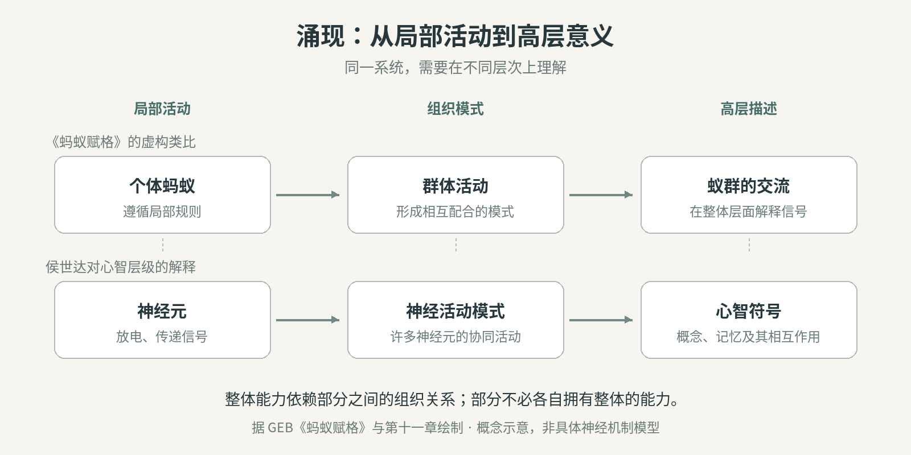
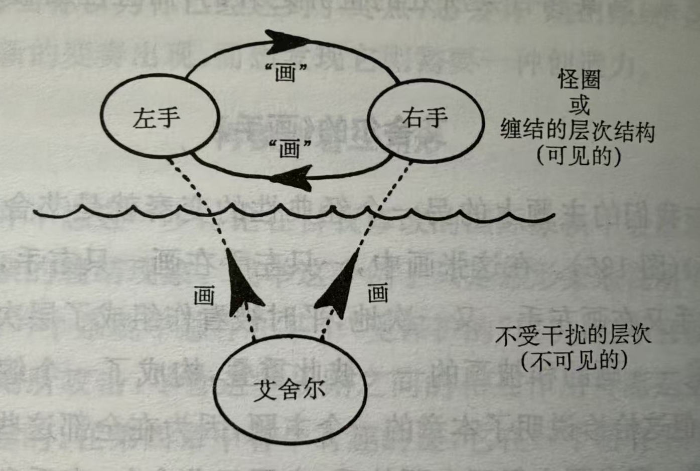

# 怪圈理论下的人工智能和自我

## 引言

人工智能说“我刚才想错了”，已经不是什么新鲜事。更值得留意的是，它可以检查先前的回答，把错误写进记忆，再据此调整下一步行动。那个被它反复谈论、修正的“我”，究竟只是语言里的一个位置，还是某种自我正在形成？

这也把问题推回了我们自己。我们习惯把“我”当作思考的起点：是我在回忆、判断和选择。但在大脑里，我们找到的是神经元的活动，以及活动之间复杂的相互影响。那个仿佛统筹一切的“我”，又从哪里来？

侯世达的怪圈理论提供了一条思路：当一个系统能够用符号表示自身，而这些符号又参与塑造系统的活动，自我便可能在这种层级间的折返中形成。理解这条思路，需要分清普通的反馈、自指，以及他所说的“怪圈”。

人工智能让这个问题有了可以拆解的具体结构。从生成文字的大语言模型，到携带记忆、持续行动的智能体，关于自身的描述究竟起了什么作用？沿着这条线索，我们或许能更清楚地判断，机器所说的“我”走到了哪一步。

## 怪圈理论

### 候世达的怪圈理论

**缠结首先发生在不同层次内部。** 神经元彼此连接，一个细胞的活动影响其他细胞，构成复杂的反馈网络。在心智层面，一个概念唤起另一个概念，记忆、判断和联想相互激活，又形成符号之间的缠结。神经活动与符号活动，是理解大脑时需要区分的两个描述层次。而符号系统内部又包含多个层级：我们可以表示一个对象，也可以表示关于这个对象的判断，再对这一判断作出判断。

艾舍尔的《画手》给出了相互生成的形象：左手画出右手，右手又画出左手。程序也可以递归调用自身。不过，循环只是起点；怎样的循环才构成怪圈，还要看它是否跨越了层级。

**从神经活动到符号活动的联系，涉及涌现。** 单个神经元并不理解一个念头，但许多神经元活动形成的组织模式，可以承载有意义的符号。符号之间的相互作用构成思维过程，而这一过程始终由神经活动实现。正如艾舍尔画《画手》：两手在画内相互生成，整幅画却依赖画外的作者。这里要分清：两手之间构成怪圈，艾舍尔与画中两手之间则是支撑关系。这个比喻尚未解释神经活动产生思维的具体机制。

GEB 的《蚂蚁赋格》进一步展示了这种层级差异：一个虚构的蚁群能够交谈，其中任何一只蚂蚁却都不理解谈话。意义出现在群体活动的组织模式中。理解整体，需要同时看见组成部分，以及它们怎样联系起来。

**心智中的怪圈，发生在符号系统内部不同层级的折返之中。** 当用来描述、审视其他符号的高层表示，也成为它所描述的过程中的对象，表征者与被表征者的层级就缠结起来。这里的折返并非指符号层与神经元层之间的往返。哥德尔编码则使这种层级折返有了严格的逻辑构造。

哥德尔编码的关键，是让数论能够谈论数论本身。符号、公式和证明都可以编码为自然数，并从编码中还原。于是，“这串符号是不是那个命题的证明”，可以转写为数之间的算术关系。原本在系统外部讨论其规则与证明的元语言，被映入了系统内部：同一个算术陈述，既在谈数，也在间接谈论陈述。

编码还不是自指的全部。通过进一步的对角化构造，可以得到一个命题，使它借助自己的编码谈论自身的可证明性。由此，系统内部的符号获得了指向自身的能力。这是侯世达连接逻辑与心智的关键类比：如同数论能够在自身内部表示自己，心智也可能用内部的符号表示产生这些符号的系统。

在侯世达看来，自我符号可以审视其他符号的活动，同时也被纳入这些活动，成为被审视、被解释和被修改的对象。怪圈就在这种符号层级的交叠中形成，而整个符号系统始终由神经活动支撑。区分这两种关系，才能看清普通反馈与怪圈的差别：关键是符号系统内部跨层级的自我指涉，单纯的神经反馈或程序递归还不够。

### 自我的产生

一个持续认识世界的系统，也需要认识自己在世界中的位置。身体怎样行动，自己知道什么、想要什么，都逐渐进入符号网络，形成以“我”为中心的自我子系统。

子系统可以理解为符号网络中的一个子集。其中的符号能够相互激发，使活动沿着内部回路延续。因此，子系统一旦形成并被激活，就能在一定条件下维持自身的活动，同时继续与其他符号交换信息。它在整体网络中具有相对的自主性，也可以作为一个复杂符号发挥作用。

自我子系统还会追踪其他符号的活动，形成关于念头的念头、关于判断的判断。于是，“我”既是思考所指向的对象，也是参与思考的符号结构。表示自身的活动，又成为自身活动的一部分。侯世达由此把怪圈放在意识解释的核心：自我在能够映照自身时产生。

这种映照还要进入行动。若一个系统只是旁观自己的决定，自我描述便没有真正参与选择；当自我符号与其他符号共同影响决定，系统对自己的理解才具有实际作用。“我”由整个过程支撑，也在过程中发挥作用。

这种在反复自指中维持自身的结构，也有另一条理论线索。[Kauffman（2005）](https://homepages.math.uic.edu/~kauffman/Eigen.pdf)沿用冯·福斯特的“本征形式”（eigenform）概念，以递归的不动点描述在操作下保持不变的形式，并将它用于自我意识：我把自己作为思考对象，仍认出那是我。这里说的是形式上的不变性，并不要求每一个念头都静止，也不自动意味着受到扰动后会恢复。

不动点（fixed point）强调状态在演化下不变；吸引子（attractor）则还涉及邻近状态的轨道向它趋近。局部渐近稳定的不动点是一类吸引子，稳定的极限环等持续变化的结构也可以是吸引子。[Shkursky（2025）](https://philarchive.org/archive/SHKTCU)进一步把意识设想为能够改变自身维持方式的吸引子。这提供了自我如何在变化中延续的建模方向，但仍是推测性框架，不能视为侯世达本人的结论或已经验证的意识机制。

### 关于自我的悖论

怪圈带来的第一个张力，是我们既由底层过程产生，又觉得自己在主导这些过程。念头修改念头，判断改变判断，从内部看，仿佛我们正在给自己编程序。如同只看见《画手》中的两只手，我们在内省中通常看不见支撑思维的神经活动，却能直接体验到“我在决定”。

第二个张力是：能够表示自己，并不意味着能够完整地理解自己。自我子系统追踪着思维，却无法穷尽产生思维的全部过程。我们知道自己作了选择，又未必知道选择究竟怎样形成。侯世达把自由意志感与这种自知、自我无知之间的平衡联系起来。

哥德尔不完全性定理揭示了这种自指能力所伴随的严格限度。借助前述编码与对角化，可以构造一个哥德尔句，其含义相当于：“这个命题在本系统中不可证明。”如果系统证明了它，就会与它所断言的内容冲突；因此，一致的系统不能证明这个句子。

第一不完全性定理的现代形式进一步表明：足以表达算术、可有效公理化的系统，只要保持一致，就必有某些命题，既不能在其中被证明，也不能被否证。能够把自身纳入表达范围，并不意味着能够用自己的规则解决所有问题。

如果沿着心智与形式系统的类比继续追问，困境就变得尖锐了：

一旦表示自身的结构的能力达到了某个临界点就乐极生悲了：保证你永远不能完整地表示自己。我们的心智或是一致的，或者是不一致的。如果我们的心智是一致的，那么哥德尔不完全性定理限制了心智的完备性，总是存在某些问题我们无法回答。更有可能的情况是我们的心智是不一致的---那就更坏了，因为那样在我的内部就会有矛盾，而我怎么可能理解它呢。

严格说，这仍是对心智的类比性追问。心智是否满足定理的适用条件、是否更可能不一致，都需另行论证；存在内部矛盾，也不等于无法认识这些矛盾。

<!-- 原著出处及“不动点”的核对范围见 Strange-Loop-sources.md。 -->

## 人工智能和自我

### 裸模型 LLM

大语言模型说出“我”，并不难。难的是，这个词是否指向一个持续起作用的自我结构。对通常推理时参数固定的 Transformer 而言，单次前向计算不会因生成了一句自我评价，就回头改写已经执行的计算或模型权重。

但固定的是参数，并非每一步的注意力分布与内部激活。生成的文字进入后续上下文，仍会改变接下来的计算。模型也可以用后面的文字检查前面的回答，因此，自回归为自我指涉提供了条件；仅凭计算图或权重不变，还不能断言它绝无怪圈。

更具体的问题是：这些自我描述能维持多久，又能影响什么？裸模型本身不负责跨任务保存经历，也不自动构成持续行动的闭环。上下文中的“我刚才错了”，是否对应稳定的自我子系统，需要从它在整个系统中的作用来判断。

### Agent 架构

当模型被接入记忆、工具与反馈回路，讨论的对象就扩展为一个持续运作的系统。它提出计划、采取行动、接收结果，再把结果纳入下一轮判断。自我描述因而有机会成为下一步行动的依据。

例如，一个智能体发现自己引用了未经核实的信息，将“我容易把推测当成事实”写入记忆，并在后续任务中主动查证。这段文字既概括了自身行为，也改变了行为。从功能层面看，高层的自我判断通过上下文约束了后续计算。类似机制已见于 [Reflexion](https://arxiv.org/abs/2303.11366)：系统将任务反馈转化为反思文字，保存下来，用于改善后续决策，无须更新模型权重。

这与侯世达强调的区别相呼应：一个系统能够描述自己的决定，与它的自我描述参与了决定，是两回事。若关于能力、目标和过往错误的符号彼此关联，又不断进入行动与反馈，它们便可能逐渐形成具有功能连续性的自我模型。是否进一步构成怪圈，要看这些表示如何指向并调节产生它们的系统。

系统提示词规定的角色、长期记忆积累的经历，以及反复修正的行为，也可能共同维持一种“代理身份”。用吸引子来理解这种身份，是假设承载它的活动模式能够吸引邻近轨道，使系统在一定扰动后仍恢复相近的自我描述与行为倾向；这不要求内部计算停在一个不动点。记住同一个名字、服从同一段提示词，还不足以证明这样的吸引性，它需要在明确的运行与环境条件下接受检验。

因此，人工智能把自我的问题变得具体了：哪些关于自身的表示会留下来，哪些会改变选择，哪些只是随上下文消失的说辞？这些可以通过观察和干预来研究。至于这种功能上的自我是否也有所感受，仍是需要另行回答的问题。

## 附录：怪圈（Strange Loop）的动力学模型

下面给出一个将上行表征与下行调制结合起来的示意模型，用于区分不动点、吸引子与宏观身份的稳定性。它是对正文讨论的建模尝试，并非侯世达本人给出的数学定义；这些方程本身也不足以证明系统具有自我或意识。

### 1. 状态空间的层级分解

设系统包含两个不同抽象尺度的描述：

* **微观状态向量**：$\mathbf{x}(t) \in \mathbb{R}^n$，代表底层的物理或计算状态。
* **宏观符号向量**：$\mathbf{s}(t) \in \mathbb{R}^m$（$m \ll n$），代表对微观活动模式的高层表征。

在这个简化模型中，宏观状态由微观状态确定，并非一组独立的自由变量。

### 2. 上行涌现与粗粒化映射（Upward Abstraction）

用粗粒化映射 $\mathcal{P}$ 表示两个描述层次的关系：

$$
\mathbf{s}(t) = \mathcal{P}(\mathbf{x}(t))
$$

假设 $\mathcal{P}: \mathbb{R}^n \to \mathbb{R}^m$ 在所讨论的区域光滑，且满足满秩条件 $\operatorname{rank}(D\mathcal{P}) = m$。在这一假设下，同一宏观取值 $\mathbf{s}_0$ 的非空原像局部构成一个 $n-m$ 维流形，刻画不同微观状态对应同一宏观表征的**多重可实现性**。

但映射只规定“哪些微观状态被视作同一个宏观状态”，并不保证这些状态会在演化中保持或被吸引。如果另作时间尺度分离假设 $\tau_{\text{micro}} \ll \tau_{\text{macro}}$，可以描述微观活动变化较快、宏观表征变化较慢的情形；变化较慢仍不等于渐近稳定。

### 3. 下行因果与参数调制（Downward Causation）

微观状态的演化允许受到宏观符号的调制：

$$
\begin{aligned}
\frac{d\mathbf{x}(t)}{dt}
&= -\frac{1}{\tau}\mathbf{x}(t)
   + \mathbf{W}_{\text{rec}}(\mathbf{s}(t))\,\sigma(\mathbf{x}(t)) \\
&\quad + \mathbf{h}(\mathbf{x}(t), \mathbf{s}(t))
   + \mathbf{W}_{\text{in}}\,\mathbf{u}(t) \\
&\equiv F\bigl(\mathbf{x}(t),\mathbf{s}(t),\mathbf{u}(t)\bigr)
\end{aligned}
$$

其中 $\tau>0$，$\sigma$ 是非线性响应函数，$\mathbf{u}(t)$ 是外部输入，$\mathbf{h}$ 表示其他耦合项。$\mathbf{W}_{\text{rec}}(\mathbf{s})$ 表示受宏观表征调制的微观**有效耦合**；在人工智能的类比中，这可以对应上下文对信息处理的调节，不必解释为训练权重的在线更新。

宏观调制本身仍由微观过程实现。代入 $\mathbf{s}=\mathcal{P}(\mathbf{x})$ 后，得到一个包含反馈的微观动力系统；存在这种反馈并不自动保证收敛，也不足以单独判定它构成怪圈。

### 4. 纠缠层级与功能性不动点（Functional Fixed Point）

为讨论通常意义上的平衡点与吸引子，先固定外部输入 $\mathbf{u}(t)=\mathbf{u}_0$，并假设有关函数连续可微、所讨论的轨道存在，定义闭环向量场：

$$
\frac{d\mathbf{x}(t)}{dt}
= G(\mathbf{x}(t)),
\qquad
G(\mathbf{x}) = F\bigl(\mathbf{x},\mathcal{P}(\mathbf{x}),\mathbf{u}_0\bigr)
$$

**不动点与稳定性。** 若存在 $\mathbf{x}^{*}$ 满足

$$
\begin{cases}
G(\mathbf{x}^{*}) = \mathbf{0}, \\
\mathbf{s}^{*} = \mathcal{P}(\mathbf{x}^{*}),
\end{cases}
$$

则 $\mathbf{x}^{*}$ 是微观动力系统的平衡点，即时间演化映射的不动点；$\mathbf{s}^{*}$ 是它对应的恒定宏观表征。这些等式本身不保证邻近轨道会向它收敛。一个常用的充分条件是：闭环雅可比矩阵

$$
DG(\mathbf{x}^{*})
= D_{\mathbf{x}}F
  + D_{\mathbf{s}}F\,D\mathcal{P}(\mathbf{x}^{*})
$$

的全部特征值实部严格小于零。其中 $F$ 的两个偏导均在 $(\mathbf{x}^{*},\mathbf{s}^{*},\mathbf{u}_0)$ 处取值。满足这一条件时，$\mathbf{x}^{*}$ 局部渐近稳定，单点集 $\{\mathbf{x}^{*}\}$ 构成一个不动点吸引子。该条件不成立时，不能仅凭这一判据作出稳定结论。

**吸引子与持续活动。** 本附录将稳定且吸引邻近轨道的非空紧不变集 $\mathcal{A}$ 称为吸引子。其吸引性可写为：对某个邻域 $U$ 中的初始状态，

$$
\operatorname{dist}\bigl(\mathbf{x}(t),\mathcal{A}\bigr)
\longrightarrow 0
\qquad (t\to\infty)
$$

不动点吸引子只是其中一种情形，稳定的极限环等集合也可以是吸引子。因此，系统受到适度扰动后恢复某种活动模式，并不要求微观活动最终停止。

**宏观身份与微观状态集合。** 同一宏观表征 $\mathbf{s}^{*}$ 对应的微观状态集合是

$$
\mathcal{M}_{\mathbf{s}^{*}}
= \mathcal{P}^{-1}(\mathbf{s}^{*})
= \{\mathbf{x}:\mathcal{P}(\mathbf{x})=\mathbf{s}^{*}\}
$$

它是映射的原像，也称纤维；即使满足前述光滑与满秩条件，也不能直接称为“吸引子流形”。还需要检查动力学是否使它保持不变，以及邻近轨道是否被吸引。一般而言，不能假定整个原像就是吸引子。

如果另行证明某个吸引子 $\mathcal{A}$ 满足

$$
\mathcal{A}\subseteq\mathcal{M}_{\mathbf{s}^{*}},
$$

那么系统可以在 $\mathcal{A}$ 内持续活动，而宏观表征始终保持为 $\mathbf{s}^{*}$。对被 $\mathcal{A}$ 吸引的轨道，连续性也保证 $\mathcal{P}(\mathbf{x}(t))\to\mathbf{s}^{*}$。这才为“微观活动不断变化，宏观身份仍可保持”提供了一个明确的模型条件。

严格地说，只有进一步建立了闭合的宏观演化方程 $\dot{\mathbf{s}}=H(\mathbf{s})$，且 $H(\mathbf{s}^{*})=\mathbf{0}$，才能把 $\mathbf{s}^{*}$ 称为该宏观系统的不动点；仅有 $\mathbf{s}=\mathcal{P}(\mathbf{x})$ 并不保证存在这样的闭合方程。本节标题中的“功能性不动点”只在这种宏观闭合成立时使用。

若某个吸引子所承载的活动进一步实现了持续的自我表征与行为调节，可以在这一建模意义上称它为**功能性吸引子**。这是对吸引子所承担功能的解释，不意味着任意吸引子就是“我”。正文中的“代理身份”采用的是这种待检验的解释；Kauffman 的本征形式则涉及形式递归中的不变性，不能直接替代上述动力学条件。外部输入持续变化时，还需把环境纳入状态，或另作非自治系统分析，不能直接沿用固定输入下的收敛结论。
